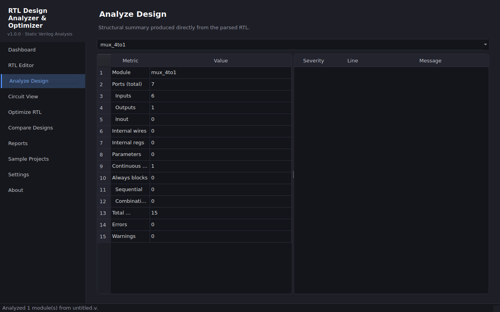
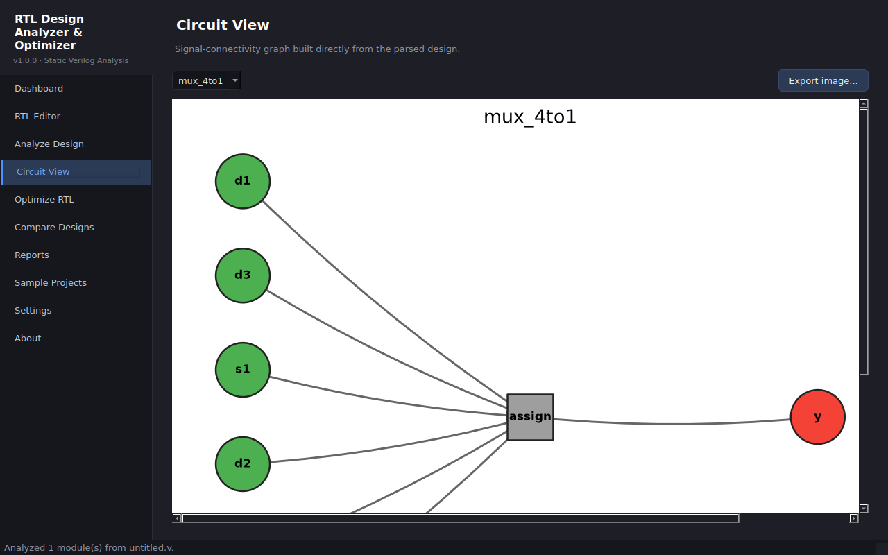

# RTL Design Analyzer & Optimizer

A desktop app (Python + PySide6) for static analysis of a **documented subset of synthesizable Verilog**: structural summary, latch-risk warnings, truth-table-verified Boolean optimization suggestions, a signal-connectivity graph, and HTML/JSON/CSV reports.




## Features
- RTL editor with syntax highlighting; open/save `.v` files
- Analyzer: modules, ports, widths, wires/regs, assigns, always blocks, operator counts
- Warnings: if-without-else / case-without-default (latch risk), undriven signals
- Optimizer: SELF-AND/OR/XOR, double-NOT, constant propagation, Boolean simplification; each verified by exhaustive truth table; apply + compare (original preserved)
- Circuit graph (NetworkX + Matplotlib) with PNG export
- Reports: HTML, JSON, CSV with version, timestamp, limitations
- 5 bundled examples; 41 automated tests

## Install & run (Windows)
```
python -m venv .venv
.venv\Scripts\activate
pip install -r requirements.txt
python -m app.main        # or double-click scripts\run_windows.bat
```
## Tests
`python -m pytest tests/ -v`

## Limitations
Not a full Verilog/SystemVerilog parser (regex-based subset, see docs/RTL_SUPPORTED_FEATURES.md). No timing, area or power results. Yosys is only *detected* in Settings; synthesis is not implemented. Operator counts are structural proxies.

## Docs
docs/ARCHITECTURE.md, USER_GUIDE.md, RTL_SUPPORTED_FEATURES.md, OPTIMIZATION_METHODOLOGY.md, TESTING.md, ROADMAP.md

MIT License.
